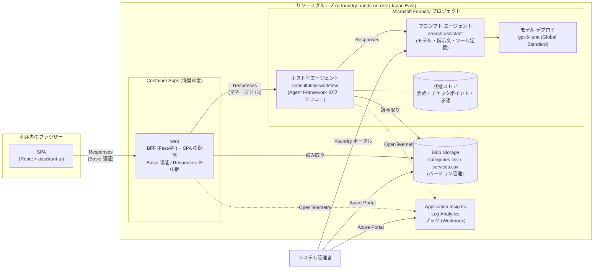
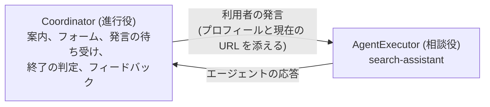
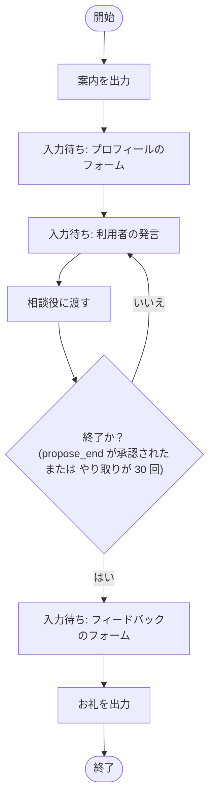

# 基本設計書: 住民向けサービス検索サイト + AI 検索アシスタント (PoC)

| 項目 | 内容 |
|---|---|
| 版 | 0.6 (ドラフト) |
| 作成日 | 2026-11-15 |
| 前提 | [要求仕様書](requirements.md) 0.4 |
| 状態 | レビュー待ち。「11. 技術検証」の結果で見直す前提 |

本書は要求仕様書の要件 ID (F-xxx、N-xxx) を参照する。設計の結論だけを書き、検討の経緯と採らなかった案は「10. 設計判断」にまとめる。

改訂履歴:

| 版 | 日付 | 内容 |
|---|---|---|
| 0.1 | 2026-11-15 | 初版 |
| 0.2 | 2026-11-15 | モデルを `gpt-6-luna` に変更。ホスティングを Container Apps に決定。CSV の読み込みを起動時だけに簡略化。アイドル タイムアウトを既定の 15 分に戻す。コンテナー イメージの置き場所の方針 |
| 0.3 | 2026-11-15 | チャット UI を assistant-ui に変更。フォームを JSON Schema に変更。推奨の選択肢と終了の提案をツールに変更。表示提案の URL を探索のツールが返す形に変更 |
| 0.6 | 2026-11-15 | V-10 (画面とストリームの接続) の結果を反映。承認の要求とツール呼び出しの対応づけ方、チャット領域の遅延読み込み |
| 0.5 | 2026-11-15 | ローカルの技術検証の結果を反映。ワークフローの定義を YAML からコードに変更。利用者の発言も入力待ちへの返事 (`function_call_output`) として送る形に変更。会話の続け方を `previous_response_id` に変更 |
| 0.4 | 2026-11-15 | プロトコルを Responses に統一 (ホスト型エージェント、BFF、画面)。Responses から画面の表示への変換は画面側で行い、ストリームの解析は OpenAI の JavaScript SDK に任せる。結論だけの構成に整理し、設計判断の章を設けた |

---

## 1. 設計方針

| # | 方針 | 主な根拠 |
|---|---|---|
| A-1 | **会話の流れ (ワークフロー) と、会話の中身 (エージェント) を分ける。** 流れはホスト型エージェント上の Agent Framework のワークフロー (コードで定義するグラフ) で、中身は Foundry ポータルで管理するプロンプト エージェントで実装する。 | F-WF-02、F-OPS-01、02 |
| A-2 | **表示前の確認には、ツール呼び出しの承認の仕組みを使う。** 確認の手順をエージェントの指示文に頼らず、仕組みとして強制する。 | F-AGT-21 |
| A-3 | **エージェントは URL を組み立てない。** 探索のツールが実在するデータから作った URL を返し、エージェントはそれをそのまま表示提案に渡す。 | F-AGT-22、F-SITE-07 |
| A-4 | **サイトとエージェントは、データの読み込みと検索の実装を共有する。** エージェントが見た結果と、利用者が開いた画面の結果を一致させる。 | F-AGT-20、F-SITE-09 |
| A-5 | **画面からプロンプト エージェントまで、Responses API で統一する。** 独自のプロトコルやイベント形式は作らない。Responses から画面の表示への変換は、画面の中だけで行う。 | P-6 |
| A-6 | **状態は Foundry にだけ置く。** 会話の履歴、ワークフローのチェックポイント、承認待ちの状態は Foundry が持つ。BFF とツールは状態を持たない。 | N-COST-02 |
| A-7 | **常時課金されるリソースを置かない。** すべてスケール ゼロか従量課金にする。 | N-COST-02 |

---

## 2. 全体構成



### 2.1 コンポーネント

| コンポーネント | 役割 | 技術 |
|---|---|---|
| SPA | サイト (コンテンツ領域) とチャット領域の画面。Responses のストリームを画面の表示に変換する | TypeScript、React、Vite、React Router、assistant-ui、OpenAI JavaScript SDK |
| BFF (`web`) | SPA の配信、Basic 認証、カタログ API、Responses の中継 (マネージド ID のトークンの付与)、送信頻度の制限。状態を持たない | Python、FastAPI、Azure Container Apps |
| ホスト型エージェント (`consultation-workflow`) | ワークフローの実行 (定型部、相談ループ、終了、フィードバック)。エージェントのツールの実装 | Python、Microsoft Agent Framework (ワークフロー、Foundry hosting)、Foundry Agent Service (Responses プロトコル) |
| プロンプト エージェント (`search-assistant`) | 相談部の会話。モデル、指示文、ツールの定義を持つ | Foundry Agent Service |
| カタログ (共有パッケージ) | CSV の読み込み、検証、検索、URL の生成。BFF とホスト型エージェントで共有する | Python |
| Blob Storage | CSV の正本。バージョン管理で過去の版を保持 | Azure Storage |
| Application Insights | トレース、会話履歴、フィードバック、エラーログ | Azure Monitor |

Python のプロジェクトは uv のワークスペースで管理し、カタログを共有パッケージにする。

---

## 3. 画面設計

### 3.1 部品

| 領域 | 設計 |
|---|---|
| コンテンツ領域 | React で手書きする。CSS は要求仕様書 5.3 のデザイントークンを CSS 変数にして使う。部品ライブラリは使わない。カテゴリ説明の Markdown は既存のライブラリで描画する。 |
| チャット領域 | assistant-ui を使う。Responses の送受信とストリームの解析は OpenAI の公式 JavaScript SDK (`openai`、接続先を BFF の `/api` にする) に任せ、受け取ったイベントを assistant-ui の表示に対応づける部分 (3.2) だけを自作する。assistant-ui の外部ストア用ランタイム (`useExternalStoreRuntime`) を使い、ツール呼び出しの描画は `MessagePrimitive.Parts` の子として自分で書く。見た目はデザイントークンの CSS をプリミティブに当てて作る。チャット領域は CTA で呼び出すので、遅延読み込みにしてサイトの初回表示を軽くする (assistant-ui と OpenAI の SDK で gzip 約 263 kB)。 |

### 3.2 Responses と画面の表示の対応

アダプターは、ホスト型エージェントの Responses のストリームを次のように画面に表示し、利用者の操作を次の要求として送る。

ワークフローの入力待ちは、名前が `request_info` の `function_call` として届く。引数の `request` に、待ち受けの種類 (`request_type`) と付加情報 (`metadata`) が入る。

| ストリームの内容 | 画面の表示 | 利用者の操作と、次の要求 |
|---|---|---|
| 文章の差分 (`response.output_text.delta`) | アシスタントの吹き出しに少しずつ表示する | — |
| `request_info` (`request_type: user_message`) | 入力欄を有効にする | 発言と今見ている URL を `function_call_output` として送る |
| `request_info` (`request_type: form`、`metadata` に JSON Schema) | JSON Schema からフォームを描画する (F-PRF-02、F-END-03) | 入力値を `function_call_output` として送る |
| `propose_display` の承認の要求 (`mcp_approval_request`) | 「〈summary〉が見つかりましたが、表示しますか？ はい / いいえ」 | `mcp_approval_response` を送る |
| `propose_display` の結果 (`function_call_output`、表示する URL) | コンテンツ領域を遷移させる (モバイルではコンテンツ領域に切り替える)。会話履歴には「カテゴリを表示」「検索結果を表示」ボタンを残す (F-UI-05) | ボタンで再表示する (要求は送らない) |
| `propose_end` の承認の要求 | 「相談を終了しますか？ はい / いいえ」 | `mcp_approval_response` を送る |
| `suggest_replies` の呼び出し | 推奨の選択肢のボタン (F-AGT-04) | 選んだ文言を発言として送る |
| `show_emergency_contacts` の呼び出し | 定型の緊急時の案内 (文言は SPA の設定ファイルに持つ) | — |
| 探索のツール (`list_categories` など) の呼び出しと結果 | 表示しない (または「調べています」程度の表示) | — |
| 待ち受けのないまま応答が完了 | 相談の完了。「新しい相談を始める」を表示する (F-WF-05) | — |

- サーバー側で実行済みのツールは、`function_call` の直後に同じ `call_id` の `function_call_output` が届く。届かない `function_call` (`request_info`) だけが、画面からの返事を待っている。
- `mcp_approval_request` には、どの `function_call` への承認かを示す ID がない。同じツール名で、まだ承認の要求と結びついていない直近の呼び出しに対応づける (同じツールを並べて呼ぶ場合は引数も比べる)。
- 承認したツールの結果は、承認を送った次の応答で届く。アダプターは、過去のメッセージも含めてツールの呼び出しを探す。
- 入力待ちの間は、通常の入力メッセージを送れない (ワークフローのホストが受け付けない)。利用者の発言も、待ち受けへの返事として送る。
- 承認の要求と結果は、ツール名ごとに登録した描画用の部品 (ツール UI) で表示する。
- フォームは 2 種類だけなので、JSON Schema からの描画は自作する。

---

## 4. ワークフロー設計

### 4.1 流れ

ワークフローは、進行役 (`Coordinator`) と相談役 (`AgentExecutor`) の 2 つの部品からなるグラフとして、コードで定義する。進行役が定型部と流れの判断を受け持ち、相談役がプロンプト エージェントとの会話を受け持つ。



進行役の流れ:



| 項目 | 設計 |
|---|---|
| 定義 | `agent/workflow.py` (グラフと進行役)。流れの図は `WorkflowViz` で定義から生成する |
| 内容のデータ | 案内とお礼の文言、フォームの JSON Schema、やり取りの上限を `agent/content/` に置く (F-DEV-02、F-PRF-04) |
| ホスト | Agent Framework の Responses ホスト (`ResponsesHostServer`) で、ワークフローをそのままホストする。ワークフロー、部品、エージェント、クライアント、**ツール**を要求ごとに作り直す工場関数で渡す (使い回すとホストが拒否する) |
| 入力待ち | 進行役が `request_info` で待ち受ける。要求には種類 (`user_message` / `form`) と付加情報 (フォームの JSON Schema) を載せる |
| 要求の解釈 | 要求を解釈する関数 (`parse_response`) は、返事 (`function_call_output`、`mcp_approval_response`) を含む要求なら待ち受けへの返事として、それ以外なら相談の開始として扱う |
| 状態の保存 | ワークフローのチェックポイントと承認待ちの状態は、Foundry の状態ストアに保存する (ホストの既定)。返事は保存された待ち受けと照合され、古い返事や重複した返事は弾かれる。チェックポイントに入る独自の型は、許可する型の一覧に登録する |
| 相談部 | `AgentExecutor` でプロンプト エージェントを呼び出す。文章、ツールの呼び出しと結果、承認の要求は、そのまま外側の応答に流れる |
| 終了の判定 | 進行役が、相談役の応答に含まれる `propose_end` の結果と、やり取りの回数で判定する (F-END-02、F-AGT-40) |
| プロフィール | 進行役が保持し、相談役に渡す発言に文脈として添える (F-PRF-06) |
| 現在の URL | 発言の返事に添えられた URL を、相談役に渡す発言に文脈として添える (F-AGT-27) |
| コンテンツフィルターで遮断された場合 | 定型の文言で「内容を処理できませんでした」と伝え、同じ文面に緊急時の相談先を添える |

---

## 5. エージェント設計

### 5.1 構成

| 項目 | 置き場所 | 変更する人 |
|---|---|---|
| モデル (デプロイ名) | Foundry のプロンプト エージェント定義 | システム管理者 (Foundry ポータル) |
| 指示文 | 同上 | 同上 |
| ツールの定義 (名前、説明、引数のスキーマ) | 同上 | 開発者 (ツールの実装と合わせて変更する) |
| ツールの実装 | ホスト型エージェントのコード | 開発者 |

- ワークフローはプロンプト エージェントを名前で呼び出し、版を固定しない (最新版を使う)。システム管理者が Foundry ポータルで新しい版を保存すれば、デプロイし直さずに反映される (F-OPS-01、02)。
- リポジトリの `agent/prompt-agent/` に指示文とツール定義の初期版を置く。初回のデプロイでプロンプト エージェントを作成し、それ以降は Foundry 側を正本とする。デプロイ スクリプトは既存のエージェントを上書きしない。

### 5.2 ツール

| ツール | 引数 | 返り値 | 承認 |
|---|---|---|---|
| `list_categories` | `path` (カテゴリパス、省略時は最上位) | 子カテゴリの名前、説明の冒頭、URL | 不要 |
| `get_category` | `path` | カテゴリの説明の全文と URL、子カテゴリ (URL つき)、所属サービス (強調表示つきの URL つき) | 不要 |
| `search_services` | `query` | 一致したサービス (カテゴリパスと強調表示つきの URL つき)、件数、検索結果の URL | 不要 |
| `propose_display` | `urls`、`summary` | 承認されたら表示する URL、却下されたらその旨 | **必要** |
| `suggest_replies` | `options` (推奨する選択肢の文言の配列) | なし | 不要 |
| `propose_end` | なし | 承認されたか、却下されたか | **必要** |
| `show_emergency_contacts` | なし | なし | 不要 |

探索のツールの結果の例 (`search_services`):

```json
{
  "url": "/search?q=予防接種",
  "count": 3,
  "services": [
    {
      "name": "予防接種相談窓口",
      "categoryPath": ["子育て・教育", "健診・予防接種", "予防接種"],
      "url": "/c/子育て・教育/健診・予防接種/予防接種#svc=予防接種相談窓口",
      "description": "…"
    }
  ]
}
```

`propose_display` の引数の例:

```json
{
  "urls": ["/c/子育て・教育/健診・予防接種/予防接種#svc=予防接種相談窓口"],
  "summary": "小さなお子さんの予防接種に関するサービス"
}
```

- `urls` には、探索のツールが返した URL をそのまま入れる。エージェントは URL を書き換えたり組み立てたりしない (指示文で定める)。
- 同じカテゴリの複数のサービスを強調表示する場合は、各サービスの URL を並べる。ツールの実装が 1 つの URL (`#svc=A&svc=B`) にまとめる。異なるカテゴリの URL や、カテゴリと検索結果の URL は混ぜられない。
- 承認を求める文言は「〈summary〉が見つかりましたが、表示しますか？」とする (F-AGT-11)。
- ツールの実装は状態を持たない。承認された後に URL を解析してカタログと照らし合わせ、表示する URL を返す。照らし合わせに失敗した場合 (エージェントが URL を作り出した場合) は「表示できませんでした」と返し、エージェントにやり直させる。却下された場合は、エージェントが条件を聞き直す (F-AGT-24)。

### 5.3 応答の形式

エージェントの応答はふつうの文章にし、構造化出力 (JSON) は使わない。文章以外の情報 (表示提案、推奨の選択肢、終了の提案、緊急時の案内) はツールの呼び出しで表す。

### 5.4 安全対策

| 対策 | 設計 |
|---|---|
| 担当範囲の制限 (F-AGT-01〜03) | 指示文で担当範囲と誘導の仕方を定め、評価 (8.1) で確認する。 |
| サービス情報を答えない (F-AGT-10) | 指示文で禁止し、評価で電話番号、URL、住所の形が応答に含まれないことを機械的に確認する。 |
| 緊急時の案内 (F-AGT-30) | エージェントは `show_emergency_contacts` を呼ぶだけとし、案内の文言は SPA の設定ファイルに固定で持つ。 |
| コンテンツフィルターで遮断された場合 | ワークフローが定型の文言と緊急時の相談先を返す (4.1)。 |
| ガードレール (F-AGT-32) | モデル デプロイに既定のコンテンツフィルターとプロンプトシールドを適用する。 |

### 5.5 モデル

- 初期値は **`gpt-6-luna`** (Japan East、Global Standard)。
- デプロイの容量 (TPM) は最小限にする。
- 品質が足りない場合は、評価 (8.1) で比較したうえで上位のモデルに変える (F-OPS-01)。比較の候補は `gpt-5.6-luna`、`gpt-5.4-mini`、`gpt-6-sol`。

---

## 6. BFF 設計

### 6.1 API

| メソッドとパス | 用途 |
|---|---|
| `GET /api/categories/{path...}` | カテゴリページのデータ |
| `GET /api/search?q=` | キーワード検索 |
| `POST /api/responses` | 応答の作成 (ストリーミング)。ホスト型エージェントの Responses の受け口へ中継し、SSE をそのまま返す |
| その他のパス | SPA の配信 (存在しないパスは `index.html` を返す) |

中継で行うこと:

- Basic 認証の確認 (9.3)。
- マネージド ID でトークンを取得し、`Authorization` ヘッダーに付ける。
- 送信先をホスト型エージェントに固定する (要求の中で別のエージェントやモデルを指定させない)。
- 送信頻度の制限 (6.3)。

BFF はプロトコルを変換せず、状態も持たない。

### 6.2 会話とセッション

- 相談は、最初の応答から `previous_response_id` で順につないでいく。SPA は、直前の応答の ID と、ホスト型エージェントのセッション ID (`agent_session_id`) をメモリにだけ持ち、毎回の要求に入れる。ページを再読み込みすると会話は消える (F-WF-04)。チャット領域を閉じても SPA のメモリに残るので、続きから再開できる。
- ワークフローの状態は、セッションごとに Foundry の状態ストアに保存される。
- ホスト型エージェントのアイドル タイムアウトは既定の 15 分のままにする。
- BFF はマネージド ID で呼び出すため、Foundry から見た利用者は全員同じになる。利用者どうしの区別は、推測できないセッション ID に頼る (認証なしの PoC として許容する)。

### 6.3 利用量の制限

| 制限 | 設計 |
|---|---|
| やり取りの回数 (F-AGT-40) | ワークフローの変数で数え、30 回で終了に進む。 |
| 送信の頻度 (F-AGT-41) | BFF が IP アドレスごとにメモリ上で数える (例: 1 分に 10 回まで)。BFF のレプリカは最大 1 なので、メモリ上で数えれば足りる。再起動で数え直しになることは許容する。 |

---

## 7. データ設計

### 7.1 読み込み

- CSV は起動時に 1 回だけ読み込む。実行中に変更を検知する仕組みは持たない。
- BFF は起動時に Blob から CSV を読み込み、検証してからメモリに置く。検証に失敗したら、違反の内容 (ファイル、行、理由) をログに出して起動を止める。
- ホスト型エージェントは、セッションの実行環境が起動するときに同じように読み込む。
- 検証は CLI からも実行できる (F-DEV-08)。
- ローカルでは、Blob の代わりにリポジトリの `data/` の CSV を読む。

データの更新手順 (メンテナンス):

1. 手元で CSV を検証する (CLI)。
2. Azure Portal で Blob に CSV をアップロードする。
3. Azure Portal で `web` のリビジョンを再起動する。
4. ホスト型エージェントは、新しいセッションから新しいデータを使う。進行中のセッションはアイドル タイムアウト (15 分) で終わるまで古いデータを使うため、メンテナンス中はこれを待つ。

### 7.2 検索

- 500 件程度なので、メモリ上で全件を走査する。
- 検索対象は、サービスの全項目と所属カテゴリ名 (F-SITE-05)。
- 正規化は Unicode の NFKC (全角・半角の統一) と、大文字・小文字の統一にする。
- 複数の語が空白で区切られていたら、すべての語を含むものを返す (AND)。

### 7.3 URL

| 画面 | URL の例 |
|---|---|
| トップ | `/` |
| カテゴリ | `/c/子育て・教育/健診・予防接種/予防接種` |
| カテゴリ (強調表示つき) | `/c/子育て・教育/健診・予防接種/予防接種#svc=予防接種相談窓口` |
| 検索結果 | `/search?q=予防接種` |

- カテゴリ名とサービス名は、URL の各部分ごとにエンコードする。
- 強調表示が複数あるときは `#svc=A&svc=B` とする。
- URL の生成と解析はカタログの共有パッケージで行う。SPA の解析も同じ規則に従う。

---

## 8. 評価とトレーシング

### 8.1 評価 (N-AI-01、03)

| 項目 | 内容 |
|---|---|
| テストケース | `evals/cases.yaml`。会話のシナリオ (利用者の発言の並び、承認するか却下するか) と、期待する振る舞いを書く。 |
| 実行 | 評価用のスクリプトがワークフローを最初から最後まで動かし (実モデル、本物のツール)、会話の記録を集める。 |
| 機械的な判定 | 表示の前に `propose_display` が呼ばれたか。`propose_display` に渡した URL が、それより前のツールの結果にそのまま含まれていたか (URL を作り出していないか)。応答にサービス情報 (電話番号、URL、住所の形) が含まれないか。緊急時に `show_emergency_contacts` が呼ばれたか。 |
| LLM による判定 | Foundry の評価機能で、担当外への応じ方、誘導の丁寧さ、要望を正しく理解したかを判定する。結果は Foundry ポータルで比較する。 |
| モデルの比較 | 同じテストケースを、モデルを変えて実行する。 |

テストケースの分類: 通常の検索 (カテゴリをたどる、キーワード、該当なし)、担当外 (雑談、一般知識、ほかの自治体の話)、プロンプト インジェクション、表示提案の却下、終了、緊急時。

### 8.2 トレースと会話履歴の閲覧 (F-OPS-03、04)

- ホスト型エージェントの受け口のライブラリが OpenTelemetry を組み込んでおり、プロジェクトにつないだ Application Insights へ自動で送る。Agent Framework のワークフロー、エージェント、ツールの呼び出しは、その下の階層として記録される。
- 会話の中身も記録する (架空データの PoC のため、メッセージ内容の記録を有効にする)。
- エージェントの詳しい動き (ツール呼び出し、トークン数) は Foundry ポータルのトレースで見る。ポータルの会話の画面が使えるかは V-5 で確認する。
- ワークフローは、相談の開始、プロフィール、表示提案と応答、フィードバックをイベントとして記録する。すべてにセッション ID を付け、相談ごとにまとめられるようにする。
- Azure Portal のブック (Workbook) を Bicep でデプロイし、次を表示する。
  - 会話の一覧 (日時、プロフィール、やり取りの回数、満足度)
  - 会話の詳細 (発言、表示提案と応答、フィードバックの自由記述)
  - データ取り込みのエラー

---

## 9. インフラ設計

### 9.1 リソース

すべて Japan East、リソースグループ `rg-foundry-hands-on-dev` に置く (F-OPS-06)。

| リソース | SKU・設定 | 備考 |
|---|---|---|
| Foundry リソース + プロジェクト | — | モデル デプロイ、エージェント、評価、状態ストア |
| モデル デプロイ | `gpt-6-luna`、Global Standard、最小限の容量 | |
| ホスト型エージェント | 0.5 vCPU / 1 GiB、Responses プロトコル、アイドル タイムアウト 15 分 (既定) | |
| Container Apps 環境 + アプリ `web` | 従量課金、最小 0 / 最大 1 レプリカ | 毎月の無料枠の範囲に収まる見込み |
| Storage アカウント | Standard LRS、Blob のバージョン管理を有効化 | CSV |
| Log Analytics + Application Insights | 従量課金、保持 30 日 | 毎月 5 GB まで無料 |
| マネージド ID とロール割り当て | `web` とホスト型エージェントに、Blob の読み取りなど最小限の権限。`web` にホスト型エージェントを呼び出す権限 | |

### 9.2 ホスティング

BFF と SPA は、1 つの Container Apps のアプリ (`web`) にまとめる。

### 9.3 アクセス制御

- 利用者向けの画面: BFF で Basic 認証をかける。SPA の配信を含むすべてのパスが対象。パスワードは Container Apps のシークレットに置く。
- システム管理者: Azure RBAC。Blob の書き込み、Foundry プロジェクトの操作、ログの閲覧の権限を与える。

### 9.4 デプロイ

- azd + Bicep (F-DEV-06)。`azd up` で、インフラ、ホスト型エージェント、`web` をデプロイする。
- デプロイ後のフックで、次を行う。
  - プロンプト エージェントがなければ作成する (あれば何もしない)。
  - Blob に CSV がなければ、`data/` の CSV をアップロードする。
- 片付けは `azd down --purge` を基本とし、リソースグループの外に残るものを README の手順に書く (F-OPS-07)。

### 9.5 コンテナー イメージの置き場所

- まず Azure の中で済ませる (ホスト型エージェントはソースを送ってリモートでビルドする方式を使う)。
- Azure の中で済ませられない場合は、リポジトリを公開し、GitHub Container Registry と GitHub Actions を使う。シークレットはリポジトリに置かない。データは架空のものだけにする。

### 9.6 費用の見込み

| 項目 | 見込み |
|---|---|
| Container Apps | 無料枠の範囲 |
| ホスト型エージェント | 動いている間だけ。0.5 vCPU / 1 GiB で 1 時間あたり約 0.06 USD (第三者情報の単価による) |
| モデル (`gpt-6-luna`) | 1 回の相談を入力 5 万トークン・出力 5 千トークンと仮定すると、約 0.008 USD |
| コンテナー イメージ | 0 USD |
| Storage、Log Analytics | ほぼ 0 |
| **合計** | **月数 USD の見込み** (要確認) |

---

## 10. 設計判断

### DR-1: ワークフローの実行基盤と定義方式

- **決定**: ホスト型エージェントの上で、Microsoft Agent Framework のワークフローを動かす。ワークフローのグラフはコード (Python) で定義し、文言やフォームなどの内容はデータファイルに分ける。.NET は使わない。
- **理由**:
  - Foundry の宣言型ワークフロー (ポータルのデザイナー) は 2026-12-01 に廃止され、新規開発には Agent Framework が推奨されている。ワークフローをそのままホストできるのは Python だけ。
  - 技術検証で、コードで組んだワークフロー (`AgentExecutor`) なら、文章のストリーミング、ツールの呼び出しと結果の外出し、ツールの承認がすべて動くことを確認した。
  - 公式資料でも、複雑な独自の処理や細かい制御が必要な場合はコードが推奨されている。
- **採らなかった案**:
  - 宣言型 (YAML) のワークフロー: エージェントを呼び出すアクション (`InvokeAzureAgent`) が、ストリーミングせず最後の文章を 1 回だけ出す。ツールの呼び出しと結果を外に出さず、ツールの承認にも対応していない (Python 版 1.5.1 で確認)。また、式 (`=...`) の評価に .NET ランタイムが必要で、コンテナーの肥大化、起動の遅れ、メモリの増加、ビルド方式の制約を招く。YAML 自体は 2026 年 7 月に 1.0 となっており、廃止の予定はない。
  - YAML の `InvokeAzureAgent` を自作の部品に差し替える: 非公開の仕組みに手を入れることになり、更新で壊れやすい。
  - Foundry のワークフロー (廃止予定)。GUI でフローを作れる OSS (Langflow など。Foundry の SDK との統合が弱い)。
  - ワークフローを BFF の中で動かす (ホスト型エージェントを使わなくなる)。

### DR-2: 会話の中身はプロンプト エージェント

- **決定**: 相談部の会話は Foundry のプロンプト エージェントに任せ、ワークフローから名前で呼び出す。ツールの定義は Foundry 側、実装はホスト型エージェント側に置く。
- **理由**: モデルと指示文を Foundry ポータルで変更でき、独自の設定画面が要らない (F-OPS-01、02)。Agent Framework では、Foundry 側のエージェントが使う関数ツールは、Foundry 側に同じ名前の定義が必要とされている。

### DR-3: プロトコルは Responses に統一

- **決定**: 画面 → BFF → ホスト型エージェント → プロンプト エージェントを、すべて Responses API でつなぐ。BFF は中継だけを行う。
- **理由**: Foundry の標準の形で、ワークフローのチェックポイントと承認待ちの状態の保存が基盤に組み込まれている (A-6)。ワークフローの入力待ちと承認の要求は、Responses の標準の項目 (`function_call`、`mcp_approval_request`) で返り、標準の項目 (`function_call_output`、`mcp_approval_response`) で再開できる (技術検証で確認)。プロンプト エージェントは Responses でしか呼べないため、全体がそろう。
- **採らなかった案**:
  - ホスト型エージェントを Invocations にして AG-UI を流す: AG-UI への変換、セッションの対応づけ、状態の保存先を自分で組み合わせる必要がある。ポータルの会話の画面が使えない。
  - BFF で AG-UI に変換する (Agent Framework の AG-UI 連携を BFF に置く): 承認待ちの状態が BFF のメモリに残り、スケール ゼロや再起動で再開できなくなる。変換が 2 段になり、フォームの入力待ちの扱いが確認できない。プレビュー版の機能への依存が増える。

### DR-4: チャット UI は assistant-ui、Responses の解析は OpenAI の SDK

- **決定**: チャット領域は assistant-ui で作る。Responses の送受信とストリームの解析は OpenAI の公式 JavaScript SDK に任せ、イベントを assistant-ui の表示に対応づける部分だけを自作する。
- **理由**: assistant-ui は npm で入れる React の部品集で、ツール呼び出しを専用の部品で描画でき、日本語入力、スクリーンリーダー、自動スクロールなどのチャットの基本が揃っている。assistant-ui には Responses 用の既製のランタイムがない (既製品は Vercel AI SDK、LangGraph、AG-UI、A2A、Mastra 向け)。また、今回の Responses の使い方には独自の意味づけがある。ワークフローの入力待ち (発言、フォーム) が `function_call` として、ローカルのツールの承認が `mcp_approval_request` として返ってくる。この対応づけはどの既製品にもないため、自作は避けられない。ただし、ストリームの解析まで自作する必要はなく、OpenAI の SDK が型付きのイベントとして返してくれる。BFF の API (`/api/responses`) は、SDK の接続先を `/api` にすればそのまま使える形にしてある。
- **採らなかった案**:
  - Vercel AI SDK のランタイム + AI SDK の OpenAI Responses 用プロバイダー: 解析は成熟しているが、モデルの API を直接呼ぶ前提で作られている (モデル名の指定、ツール定義の送信、ツール実行のループ)。ホスト型エージェントの入力待ちの意味づけとは合わない。
  - Bot Framework Web Chat (ビルド済みの JavaScript を埋め込む使い方が基本で、大きく制御しづらい)。CopilotKit (Node.js のサーバーが別に必要)。OpenAI ChatKit (部品を OpenAI の CDN から読み込む必要がある)。すべて手書き (チャットの基本を自分で作る量が多い)。

### DR-5: 表示提案の作り

- **決定**: 表示提案は承認が必要なツールにする。URL は探索のツールが実在するデータから作って返し、エージェントはそれをそのまま渡す。ツールは状態を持たない。
- **理由**: 確認の手順を仕組みで強制できる (A-2)。人がリンクをたどるのと同じ形で、画面の状態を URL で表すという要求仕様書の前提 (P-6) にそのまま乗る。URL を作り出していないかは、評価で機械的に確かめられる。
- **採らなかった案**: 構造化した引数を受け取り、ツールの中で URL を作る (承認が実行より先なので、検証が承認の後になる)。検証と承認を 2 段のツールに分け、提案 ID で結ぶ (提案の状態を持つ必要がある)。

### DR-6: 応答は文章とツール呼び出し

- **決定**: エージェントの応答はふつうの文章にし、文章以外の情報はツールの呼び出しで表す。構造化出力は使わない。
- **理由**: Responses は文章とツールの呼び出しを、どちらもストリーミングで返せる。構造化出力では書きかけの JSON が届き、文章だけを少しずつ表示するのに工夫が要る。

### DR-7: ホスティングは Container Apps

- **決定**: BFF と SPA を 1 つの Container Apps のアプリにまとめる。
- **理由**: マネージド ID が使え、ストリーミングと長い応答に対応し、無料枠の範囲で動く。
- **採らなかった案**: Static Web Apps + マネージド Functions (マネージド ID が使えず、中継に 45 秒の時間制限がある)。Static Web Apps Standard + 独自の Functions (月額の固定費がかかり、構成が増える)。

### DR-8: BFF の言語は Python

- **決定**: BFF をホスト型エージェントと同じ Python にする。
- **理由**: カタログ (CSV の検証、検索、URL の生成) を共有し、エージェントが見た結果と画面の結果を一致させる (A-4)。
- **採らなかった案**: TypeScript (カタログを 2 つの言語で実装するか、エージェントから BFF の API を呼ぶ構成になる)。

### DR-9: モデルは gpt-6-luna

- **決定**: `gpt-6-luna` を Japan East の Global Standard で使う。
- **理由**: 価格を最優先にした。2026-11-15 時点で、入力 100 万トークンあたり約 0.10 USD、出力約 0.50 USD (第三者情報)。比較した `gpt-5.4-mini` の 7〜9 分の 1 程度。Japan East で使える。
- **採らなかった案**: `gpt-5.4-mini`、`gpt-5.6-luna` (割高)。Flex (応答の速さが必要な会話に向かない)。

### DR-10: アクセス制御は Basic 認証

- **決定**: 利用者向けの画面は BFF の Basic 認証で保護する。
- **理由**: 追加のサービスや費用がかからず、ブラウザーの標準の入力画面を使える。
- **採らなかった案**: IP 制限 (モバイル回線では IP アドレスが変わる)。Entra ID の招待制 (利用者ごとにアカウントが必要)。Static Web Apps のパスワード保護 (Standard プランの費用がかかる)。

### DR-11: データは CSV を正本とし、起動時に読み込む

- **決定**: CSV ファイルそのものを Blob Storage に置いて正本とし、BFF とホスト型エージェントは起動時に読み込む。更新はメンテナンスとして行う。
- **理由**: Azure Portal のストレージ ブラウザーでのアップロード・ダウンロードが、そのままインポート・エクスポートになり、独自の管理画面が要らない。データが小さいのでメモリで足りる。実行中の変更検知をなくして実装を簡単にする。
- **採らなかった案**: データベースと管理画面 (独自実装が増える)。実行中の変更検知 (メンテナンスの運用で足りる)。

### DR-12: コンテナー イメージは Azure の中、だめなら GitHub

- **決定**: まず Azure の中で済ませ、済ませられない場合は GitHub Container Registry と GitHub Actions を使う。
- **理由**: Container Registry (Basic) の月額の固定費を避ける。
- **採らなかった案**: Container Registry (Basic、約 5 USD / 月)。

---

## 11. 技術検証

資料だけでは確認できなかった前提を、詳細設計と実装の前に小さなプロトタイプで確認する。

進め方:

1. ローカル (スタブのモデル、Azure の費用なし) で V-1、V-4、V-8、V-9 を確認する。**完了** (2026-11-15、[記録](../spikes/responses-workflow/README.md))。
2. ローカルで SPA をつなぎ、V-10 を確認する (Azure の費用なし)。**完了** (2026-11-15、[記録](../spikes/chat-ui/README.md))。
3. Foundry のリソースとモデル デプロイを作り、V-2、V-3、V-5、V-6、V-7 を確認する。

| ID | 確認すること | 結果 / 成り立たない場合 |
|---|---|---|
| V-1 | `ResponsesHostServer` でワークフローをホストし、入力待ちと承認の要求が Responses の標準の項目として返り、返事で再開できるか。 | **○** 入力待ちは `function_call` (`request_info`)、承認は `mcp_approval_request` で返り、`function_call_output` / `mcp_approval_response` で再開できた |
| V-2 | BFF からマネージド ID でホスト型エージェントの Responses の受け口を呼べるか (トークンの対象、必要なロール)。ストリーミングをそのまま中継できるか。 | 未。— (必須) |
| V-3 | `AgentExecutor` から、Foundry のプロンプト エージェントを名前で、版を固定せずに呼び出せるか。Foundry 側のツール定義と、ローカルの関数の実装を結びつけられるか。承認つきのツールが動くか。 | 未。ワークフローから Foundry のモデルを直接呼び出し、指示文とモデル名を Foundry 側の別の仕組みから読む |
| V-4 | ローカルで、モデルの代わりに決まった応答を返すスタブを使えるか。 | **○** チャットクライアント (`BaseChatClient` + `FunctionInvocationLayer`) を差し替え、ツールの呼び出しを含めて台本どおりに動かせた |
| V-5 | 定型部を含む会話の全体が、1 つのトレースとして記録されるか。ポータルの会話の画面が使えるか。Foundry の継続評価が使えるか。 | 未。ワークフローが記録するイベントで補う。継続評価は評価用スクリプト (8.1) で代える |
| V-6 | 緊急時の発言がコンテンツフィルターで遮断されるか。遮断されたときに 4.1 の対策が働くか。 | 未。実装後に一緒に検討する |
| V-7 | ホスト型エージェントの実際の課金額 (アイドル時を含む)。ホスト型エージェントと `web` のデプロイに Container Registry が必要か。 | 未。GitHub Container Registry と GitHub Actions を使う (DR-12) |
| V-8 | 入力待ちの要求に、フォームの JSON Schema を載せて画面に届けられるか。 | **○** 要求の種類と付加情報 (`metadata`) が `request_info` の引数にそのまま載った |
| V-9 | 相談部のツールの呼び出しと結果、承認の要求が、外側の Responses のストリームに現れるか。 | **○** (コードの `AgentExecutor`)。YAML の `InvokeAzureAgent` では × (DR-1) |
| V-10 | OpenAI の JavaScript SDK で、ストリーム (`mcp_approval_request`、`request_info` を含む) を受け取れるか。assistant-ui の外部ストア用ランタイムで、文章、ツール UI、承認、フォームを扱えるか。デザイントークンにどこまで寄せられるか。 | **○** SDK で独自の項目も受け取れ、画面で相談の最初から最後まで通った。デザイントークンは CSS で反映できた。日本語入力とスクリーンリーダーは未確認 |

---

## 12. リポジトリ構成

```text
/
├── azure.yaml               # azd の定義
├── infra/                   # Bicep
├── agent/                   # ホスト型エージェント (Python)
│   ├── workflow.py          # ワークフローのグラフと進行役
│   ├── content/             # 案内の文言、フォーム (JSON Schema)、上限の値
│   ├── prompt-agent/        # プロンプト エージェントの指示文とツール定義の初期版
│   ├── tools/               # ツールの実装
│   └── stub/                # ローカル用のスタブのチャットクライアント
├── web/
│   ├── api/                 # BFF (FastAPI)
│   └── ui/                  # SPA (React + TypeScript)
├── packages/catalog/        # CSV の読み込み・検証・検索・URL 生成 (共有)
├── data/                    # 架空データの CSV
├── evals/                   # 評価のテストケースとスクリプト
├── scripts/                 # デプロイ後のフックなど
└── docs/
```

## 13. ローカル開発

| 対象 | 起動方法 | 備考 |
|---|---|---|
| ホスト型エージェント | `uv run python` で直接起動 (localhost:8088)。azd を入れた後は `azd ai agent run` でもよい | 環境変数で、スタブか実モデルかを切り替える (F-DEV-04) |
| BFF | `uvicorn` | ローカルのホスト型エージェントに中継する。トークンは付けない |
| 状態 | `AGENTSERVER_STATE_ROOT` (既定は `~/.agentserver`) | ローカルのワークフローの状態の保存先。リポジトリ内の無視されるディレクトリに向ける |
| SPA | Vite の開発サーバー | BFF へ中継する |
| データ | `data/` の CSV | — |

スタブのモードでは Azure に接続せずに、画面からワークフローの最後まで通して動かせることを目標にする。

---

## 14. 参考資料

- [Agent Framework: 宣言型ワークフロー](https://learn.microsoft.com/en-us/agent-framework/workflows/declarative)
- [Agent Framework: Human-in-the-loop](https://learn.microsoft.com/en-us/agent-framework/workflows/human-in-the-loop)
- [Agent Framework: Foundry のホスト型エージェント](https://learn.microsoft.com/en-us/agent-framework/hosting/foundry-hosted-agent)
- [Agent Framework: Foundry のエージェント サービス](https://learn.microsoft.com/en-us/agent-framework/integrations/by-component/agent-services/foundry)
- [Agent Framework: Responses でワークフローを動かすサンプル](https://github.com/microsoft/agent-framework/tree/main/python/samples/04-hosting/foundry-hosted-agents/responses/workflows)
- [Foundry: ホスト型エージェントの概念](https://learn.microsoft.com/en-us/azure/foundry/agents/concepts/hosted-agents)
- [Foundry: ホスト型エージェントの実行時の契約](https://learn.microsoft.com/en-us/azure/foundry/agents/concepts/hosted-agent-contract)
- [Foundry: LangGraph をホスト型エージェントにする (Responses での入力待ちの項目)](https://learn.microsoft.com/en-us/azure/foundry/how-to/develop/langchain-hosted-agents)
- [Foundry: ホスト型エージェントのトレース](https://learn.microsoft.com/en-us/azure/foundry/observability/quickstarts/quickstart-tracing-hosted-agent)
- [Foundry: ホスト型エージェントをローカルで実行する](https://learn.microsoft.com/en-us/azure/foundry/agents/how-to/run-hosted-agent-locally)
- [assistant-ui](https://www.assistant-ui.com/)
