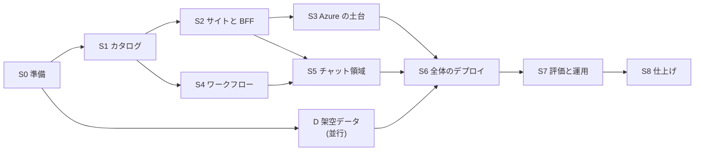

# 実装計画: 住民向けサービス検索サイト + AI 検索アシスタント (PoC)

| 項目 | 内容 |
|---|---|
| 版 | 0.1 (ドラフト) |
| 作成日 | 2026-11-16 |
| 前提 | [要求仕様書](requirements.md) 0.7、[基本設計書](design.md) 0.10 |
| 状態 | レビュー待ち |

基本設計書の構成 (12. リポジトリ構成) に沿って、技術検証のコード (`spikes/`) を本実装に置き換えていく順番と、各段階の完了の条件を決める。

---

## 1. 進め方の方針

| # | 方針 | 理由 |
|---|---|---|
| P-1 | **ローカルのスタブで先に通し、Azure は後から載せる。** 各段階はスタブのモードで画面から確かめられる状態で終える。 | Azure の費用と待ち時間なしで、流れと画面を作り込める (F-DEV-03、04) |
| P-2 | **Azure の未確認事項は早めに潰す。** サイトだけの段階で一度 Azure にデプロイし、BFF のマネージド ID (V-2)、`web` のイメージの置き場所 (V-7)、azd で Foundry と Bicep を同居させられるか (V-11)、共有パッケージを含めてホスト型エージェントをビルドできるか (V-12) を確かめる。 | 最後にまとめてデプロイすると、インフラの作り直しが全体に響く |
| P-3 | **エージェントの品質は実モデルで詰める。** スタブは流れと画面の確認用に限り、指示文とツールの振る舞いは評価 (8.1) を回して直す。 | F-DEV-07、N-AI-01 |
| P-4 | **AI エージェントの要件は妥協しない。それ以外は最小限にする。** サイトの見た目と機能はデザインレビューの範囲で止め、管理画面やテスト基盤は足さない。 | PoC の目的 |
| P-5 | **段階ごとにブランチを切り、終わったら `main` に取り込む。** ドキュメントの更新はそのつどコミットする。 | 変更を追いやすくする |

---

## 2. 段階

### S0: 準備

| 作業 | 内容 |
|---|---|
| ブランチ | 今のブランチ (`spike/responses-workflow`) から `main` を作る。以降は段階ごとのブランチで進める |
| Python | ルートに uv のワークスペースを作る (メンバー: `packages/catalog`、`agent`、`web/api`)。ruff と pytest を入れる |
| SPA | `web/ui` に Vite + React + TypeScript を作る。Vitest を入れる |
| 起動 | `.claude/launch.json` と README に、ローカルの起動方法 (13. ローカル開発) を書く |

完了の条件: 空のパッケージで `uv run pytest` と `npm test` が通る。

### S1: カタログ (`packages/catalog`)

| 作業 | 内容 |
|---|---|
| 読み込みと検証 | CSV (BOM 付き UTF-8) の読み込み。F-DAT-10〜15 の検証。違反はファイル・行・理由を返す |
| 検索 | NFKC と大文字・小文字の統一、空白区切りの AND、対象はサービスの全項目と所属カテゴリ名 (7.2) |
| URL | 生成と解析、表記ゆれの吸収 (7.3、5.2) |
| CLI | `catalog validate <dir>` (F-DEV-08) |
| テスト用データ | `packages/catalog/tests/fixtures/` に小さなデータ (カテゴリ 20、サービス 50 程度) を置き、制約の境目 (同名カテゴリ、同じ施設の別窓口、総合案内窓口) を含める。`data/` は段階 D が作るので触らない |

完了の条件: 検証、検索、URL のテストが通る。わざと壊した CSV で、違反の内容が出る。

### D: 架空データ (並行)

| 作業 | 内容 |
|---|---|
| 区 | 出茂市の区 (5〜8) を決める |
| カテゴリ | 3 階層の木と、読み物としての説明文 (F-SITE-02) |
| サービス | 約 500 件。F-DAT-40〜44 を満たす (example.com のドメイン、実在しない電話番号、同名カテゴリ、同じ施設の別窓口、総合案内窓口) |
| 検証 | S1 の CLI で検証する |

S1 のカタログの CSV の形が決まれば、ほかの段階と並行して進められる。

完了の条件: CLI の検証が通る。カテゴリをたどって、どの末端にもサービスがある。

### S2: サイトと BFF

| 作業 | 内容 |
|---|---|
| BFF (`web/api`) | カタログ API (`/api/categories/...`、`/api/search`)、SPA の配信、Basic 認証、起動時の CSV の読み込み (ローカルは `data/`) |
| SPA | デザイントークン (3.3) を CSS 変数に。ヘッダー (市章、検索)、トップ、カテゴリ、検索結果。`#svc=` の強調表示とスクロール (F-SITE-08)。PC とモバイルの配置と、下部の「AI に相談する」ボタン (トップでは CTA が隠れたら出す) |
| チャット領域の枠 | 開く・閉じる、モバイルでの領域の切り替え、遅延読み込みの入口だけ作る (中身は S5) |

完了の条件: ローカルで、トップからカテゴリをたどる、検索する、強調表示つきの URL を開く、がデザイン案どおりに動く (PC とモバイル)。

### S3: Azure の土台

| 作業 | 内容 |
|---|---|
| azd | ルートに `azure.yaml` と `infra/` (Bicep) を作る。Storage (Blob のバージョン管理)、Container Apps 環境と `web`、Log Analytics と Application Insights、マネージド ID とロール、予算アラート (N-COST-04) |
| 確認 | V-12: ホスト型エージェントのリモート ビルドは `agent/` だけを送るので、ワークスペースの `catalog` をどう含めるか (デプロイ前のフックで同梱する、など)。V-11: Foundry の部分 (azd の Foundry 向けの仕組み) と Bicep を 1 つの azd プロジェクトで扱えるか。V-7: `web` のイメージを置く場所 (Container Registry を置くか、GitHub に逃がすか、DR-12)。V-2: `web` のマネージド ID でホスト型エージェントを呼べるか (技術検証のホスト型エージェントを相手に、中継だけ先に試す) |
| デプロイ | S2 のサイトを `azd up` でデプロイし、Basic 認証の向こうでサイトが見える |

完了の条件: 上記 3 つの確認の結果を基本設計書の 11 章に記録し、必要なら設計を直す。

### S4: ワークフロー (`agent/`)

| 作業 | 内容 |
|---|---|
| 進行役とグラフ | 技術検証の `main_v10.py` を `agent/workflow.py` に整理する。案内 → フォーム → 相談ループ → 終了 → フィードバック (4.1) |
| 内容のデータ | 案内とお礼の文言、フォームの JSON Schema、やり取りの上限を `agent/content/` に (F-DEV-02、F-PRF-04) |
| ツール | カタログを使った探索のツール。承認なしの `propose_display` (DR-5)、`suggest_replies`、承認つきの `propose_end`、`show_emergency_contacts` |
| 文脈 | プロフィール、現在の URL、案内カードを押したこと (`opened`) を、相談役への発言に添える |
| 安全対策 | コンテンツフィルターで遮断されたときの日本語の定型文と相談先 (V-6) |
| 記録 | 相談の開始、プロフィール、表示提案と応答、フィードバックをイベントとして記録する (8.2) |
| スタブ | 台本どおりに動くスタブのチャットクライアント。台本はシナリオごとに切り替えられる |
| プロンプト エージェント | `agent/prompt-agent/` に指示文とツール定義。なければ作る (あれば何もしない) スクリプト |
| テスト | スタブで、相談の最初から最後まで、案内カード → 見つかった → 終了 → フィードバック、の流れを pytest で通す |

完了の条件: スタブのモードで、CLI の操作 (技術検証の `drive.py` の後継) で相談を最後まで通せる。実モデルのモードで、ローカルから Foundry のプロンプト エージェントを使って相談できる。

### S5: チャット領域

| 作業 | 内容 |
|---|---|
| 中継 | BFF の `/api/responses` (ローカルはトークンなし、Azure ではマネージド ID)。送信頻度の制限 (6.3) |
| アダプター | 技術検証の `consultation.ts` を整理し、3.2 の対応表をすべて実装する。対応づけの部分は Vitest で試す |
| 部品 | 吹き出し、案内カード (URL から要約を作る、表示中 / もう一度表示)、推奨の選択肢、フォーム (JSON Schema から)、入力欄 (フォームの間は隠し、下から出す。送信は ↑)、緊急時の案内、未完了の応答の扱い |
| 操作 | 「はじめからやり直す」(F-WF-03)、閉じても続きから (F-WF-04)、「新しい相談を始める」(F-WF-05)、モバイルで「表示する」を押すとコンテンツ領域へ切り替え (F-UI-04) |
| アクセシビリティ | キーボード操作、新しいメッセージの通知 (N-A11Y-02、03) |

完了の条件: スタブのモードで、画面から相談を最後まで通せる (PC とモバイル)。実モデルのモードで、ローカルの画面から相談できる。

### S6: 全体のデプロイ

| 作業 | 内容 |
|---|---|
| デプロイ | ホスト型エージェント、`web`、データを `azd up` でデプロイ。デプロイ後のフックでプロンプト エージェントと CSV を用意する (9.4) |
| 確認 | Azure 上の画面から相談を最後まで通す。初回の応答の待ち時間 (コンテナーの起動) の見せ方を確かめる |
| 片付け | 技術検証で作ったリソースグループを削除する (`azd down --purge`) |

完了の条件: Azure 上で、データの更新手順 (7.1) を含めて動く。

### S7: 評価と運用

| 作業 | 内容 |
|---|---|
| 評価 | `evals/cases.yaml` (8.1 の分類)、実行スクリプト、機械的な判定。Foundry の評価機能での LLM による判定。指示文の改善を回す |
| モデルの比較 | 同じテストケースを別のモデルで回す (N-AI-03) |
| トレース | ブック (Workbook) を Bicep で。会話の一覧、会話の詳細、データ取り込みのエラー (8.2)。V-5 の残り (ポータルの会話の画面、継続評価) を確認する |

完了の条件: 評価を 1 コマンドで回せ、結果を Foundry ポータルで比べられる。ブックで会話とフィードバックを追える。

### S8: 仕上げ

| 作業 | 内容 |
|---|---|
| ドキュメント | README (前提、ローカル開発、デプロイ、データの更新、片付けと残るもの (F-OPS-07))。基本設計書を実装に合わせて直す |
| 確認 | 対応ブラウザー (N-ENV-01)、スクリーンリーダー、費用 (V-7 の課金額) |
| 整理 | `spikes/` を残すか消すかを決める |

---

## 3. 決めてほしいこと

| # | 内容 | 案 |
|---|---|---|
| Q-1 | Azure のリソースグループ。基本設計書は `rg-foundry-hands-on-dev`、技術検証で作ったものは `rg-consultation-workflow-dev-a0f264e2`。 | **新しく作り直す** (S3)。技術検証のものは S6 で削除する。作り直しの費用はほぼかからない |
| Q-2 | 架空データ (約 500 件) の作り方。 | **Claude が CSV を直接書く** (別のセッションで並行)。Foundry のモデルに作らせる案もあるが、整合性の確認と手直しの手間が増える |
| Q-3 | `main` ブランチ。まだないので、今のブランチから作る。 | **今のブランチの先端から `main` を作る** (S0) |
| Q-4 | GitHub のリポジトリを作る時期 (F-DEV-06)。 | **S3 の V-7 の結果しだい**。GitHub に逃がす場合はそのとき公開リポジトリを作る。それ以外は S8 までに作る |
