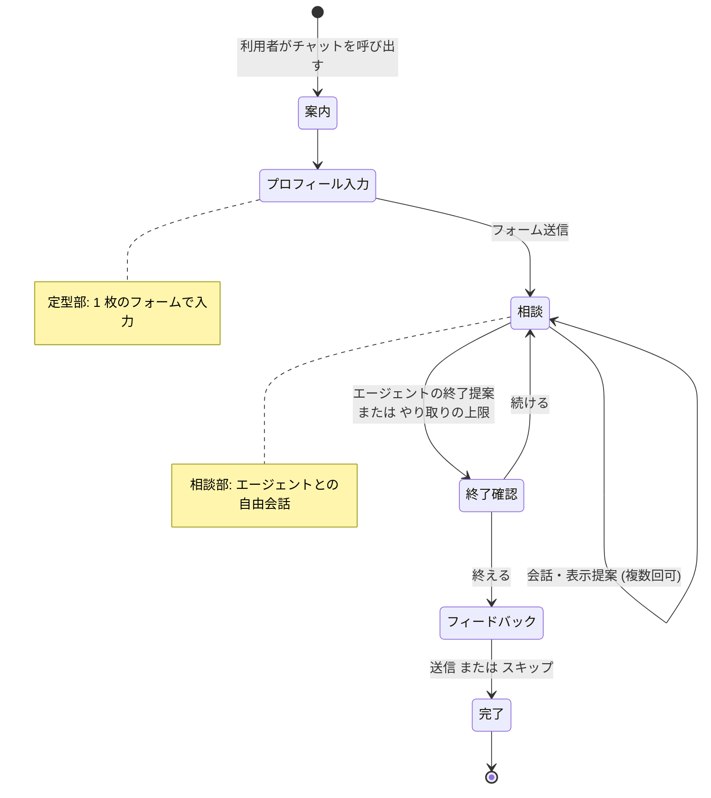

# 要求仕様書: 住民向けサービス検索サイト + AI 検索アシスタント (PoC)

| 項目 | 内容 |
|---|---|
| 版 | 0.7 (ドラフト) |
| 作成日 | 2026-11-15 |
| 状態 | レビュー待ち |

改訂履歴:

| 版 | 日付 | 内容 |
|---|---|---|
| 0.1 | 2026-11-15 | 初版 |
| 0.2 | 2026-11-15 | フォーム入力の採用、チャットの呼び出し方式、「相談を終える」の廃止、CSV を名前ベースに変更、デザイン仕様の具体化、市名の決定、リソースグループの方針、未決事項 D-1・D-2・D-4 の解決 |
| 0.3 | 2026-11-15 | データ取り込み時の扱い (F-DAT-15) を変更。フォームを特定の形式 (Adaptive Card) に限定しない表現に変更。技術調査と技術検証の章を基本設計書へ移し、未決事項 D-3・D-5 を解決 |
| 0.4 | 2026-11-15 | ワークフローの定義を宣言型 (YAML) からコードに変更 (F-WF-02、F-PRF-04、F-DEV-01、02、D-1) |
| 0.5 | 2026-11-15 | デザインを「面影を残しつつ今時の見た目」に変更 (F-UI-10、11)。フロントエンドの実装前のデザインレビューを追加 (F-UI-13) |
| 0.6 | 2026-11-16 | デザインレビューの指摘を反映。表示提案を「確認の質問 + はい / いいえ」から「案内カード + 表示する」に変更し、表示後に見つかったかを聞く流れにした (F-AGT-11、21、23、24、F-END-02、F-UI-04〜06)。注意書きの常時表示をやめた (F-AGT-31、F-UI-08)。フォーム入力中の入力欄と送信ボタンの要件を追加 (F-UI-09) |
| 0.7 | 2026-11-16 | トップページの主役を AI 相談の CTA にし、検索をヘッダーに移した (F-SITE-10、F-UI-02)。グローバルメニューを置かない (F-SITE-11)。配色をデザインレビューで決定 (5.3) |

---

## 1. 概要

### 1.1 目的

Microsoft Foundry の味見を目的とした PoC として、架空の自治体「出茂市 (でもし)」の住民向けサービス検索サイトと、その検索を代行する AI 検索アシスタントを構築する。

- 非公開で運用し、コストは最小限に抑える。
- ただし設計は実運用を見据え、安価な代替サービスへの置き換えはしない。

### 1.2 基本方針

| # | 方針 |
|---|---|
| P-1 | **AI エージェントまわりの機能要件は妥協しない。** それ以外 (サイトの作り込み、データ管理、運用機能など) は最小限とする。 |
| P-2 | **Microsoft Foundry を積極的に使用する。** モデル呼び出しは Foundry が提供する API / SDK を原則とし、独自実装に寄せない。 |
| P-3 | **独自の管理画面は作らない。** システム管理者は Azure Portal / Foundry ポータルにアクセスできる前提で、管理機能はそれらと既存 OSS で代替する。 |
| P-4 | **可能な限り低廉な Azure マネージドサービスまたは OSS を組み合わせる。** 常時課金されるリソースを避け、利用がないときは課金がほぼゼロになる構成を優先する。 |
| P-5 | **主役はサイト。** AI 検索アシスタントは、利用者が呼び出したときだけ現れる補助役とする。 |
| P-6 | **既存の構造で表現できるものに新しい仕組みを足さない。** 特に次の 3 点を設計の前提とする。 |

P-6 の前提:

1. **コンテンツ領域の状態は URL で表す。** エージェントによる画面更新は「遷移先 URL の提案」であり、専用のプロトコルを設けない。これにより「強調表示以外はすべて利用者自身が行える操作」という制約が構造的に保証される。
2. **カテゴリ階層をエージェントの索引として使う。** カテゴリ説明は読み物として書かれているため、エージェントは人と同じように階層をたどって探索できる。
3. **モデルや指示文の設定は Foundry のエージェント定義に置く。** 「ソースコード改修なしのモデル変更」のために独自の設定画面を作らない。

### 1.3 スコープ

対象:

- 住民向けサービス検索サイト (コンテンツ領域)
- AI 検索アシスタント (チャット領域)
- カテゴリ・サービスデータの管理 (Azure Portal 等による代替)
- 会話履歴・フィードバックの閲覧 (Azure Portal 等による代替)
- 架空データ (自治体、カテゴリ、サービス約 500 件) の作成
- ローカル開発環境 (ワークフロー作成、モデルのスタブ化)
- IaC によるデプロイ

対象外:

- 利用者の認証・会員機能
- 独自の管理画面
- サービスの個別ページ
- 多言語対応
- 可用性・性能の保証 (PoC のため)

### 1.4 用語

| 用語 | 意味 |
|---|---|
| サービス | 住民向けの窓口・制度などの単位。同じ施設でも窓口が複数あれば別のサービスとして扱う。 |
| カテゴリ | サービスを分類する最大 3 階層の木構造。各カテゴリは個別ページを持つ。 |
| カテゴリパス | 最上位から対象カテゴリまでのカテゴリ名の並び (例: 「子育て・教育 > 健診・予防接種 > 予防接種」)。カテゴリを一意に特定する。 |
| コンテンツ領域 | カテゴリページや検索結果を表示する領域。サイトの本体。 |
| チャット領域 | AI 検索アシスタントとの会話を表示する領域。 |
| 定型部 | ワークフローのうち、決まった入力で進む部分 (プロフィール入力、フィードバック)。 |
| 相談部 | ワークフローのうち、エージェントと自由に会話する部分。 |
| 表示提案 | エージェントが、見つけた行き先 (カテゴリや検索結果) を案内カードとしてチャットに出すこと。利用者がカードの「表示する」を押すと表示される。 |
| 案内カード | 表示提案をチャットに出す部品。行き先の要約と「表示する」ボタンを持つ (F-UI-05)。 |

---

## 2. 利用者と利用環境

| 利用者 | 説明 | 利用環境 |
|---|---|---|
| 住民 (利用者) | サービスを探す人。認証なし (ただし PoC としてのアクセス制御あり)。 | **モバイルを基本**とし、PC にも対応する。 |
| システム管理者 | データ管理、モデル変更、会話履歴・フィードバックの閲覧を行う。 | Azure Portal / Foundry ポータル / Excel などの既存ツール |
| 開発者 | ワークフローやエージェントを開発・検証する。 | ローカル環境 |

---

## 3. 機能要件: 検索サイト (コンテンツ領域)

| ID | 要件 |
|---|---|
| F-SITE-01 | カテゴリは最大 3 階層とし、トップから階層をたどって閲覧できる。 |
| F-SITE-02 | 各カテゴリは個別ページを持ち、名称・説明 (読み物としての性格を持つしっかりめの文章)・子カテゴリ一覧・所属サービス一覧を表示する。 |
| F-SITE-03 | サービスはカテゴリページや検索結果の中に、名称・説明・住所・電話番号・ホームページ URL をまとめて表示する (サービスの個別ページは持たない)。 |
| F-SITE-04 | 1 つのサービスは 1 つのカテゴリにのみ属する。 |
| F-SITE-05 | キーワード検索は、サービスの全項目と所属カテゴリ名を対象とした部分一致検索とする。全角・半角、大文字・小文字の違いは吸収する。 |
| F-SITE-06 | 検索条件と検索結果の表示方法に特別な要件はない。 |
| F-SITE-07 | 画面の状態 (表示中のカテゴリ、強調表示するサービス、検索条件) はすべて URL で表す。URL を開けば同じ画面が再現できる (URL の形式は 6.3 を参照)。 |
| F-SITE-08 | URL で指定されたサービスを強調表示し、その位置までスクロールする。強調表示の対象は 1 件〜数件のサービスとする。 |
| F-SITE-09 | 強調表示を除き、エージェントが作る画面状態はすべて利用者自身の操作でも到達できる。 |
| F-SITE-10 | トップページのファーストビューの主役は、AI 検索アシスタントを呼び出す CTA (「AI に相談する」) とする。見出しと説明で、AI に相談しながら探せるサービスであることを伝える。キーワード検索の入力欄は、ほかのページと同じくヘッダーの右上に置き、ファーストビューには置かない (CTA を 1 つに絞り、迷わせないため)。 |
| F-SITE-11 | ヘッダーはサイト名 (トップへのリンク) と検索だけとし、グローバルメニュー (「カテゴリ一覧」など) は置かない。カテゴリはトップページから階層をたどる (F-SITE-01)。 |

---

## 4. 機能要件: AI 検索アシスタント (チャット領域)

### 4.1 ワークフロー全体

| ID | 要件 |
|---|---|
| F-WF-01 | ワークフローは「案内 → プロフィール入力 (定型) → 相談 (エージェント) → 終了 → フィードバック (定型)」の順で進む。 |
| F-WF-02 | ワークフローの流れは、アプリの処理の中に埋め込まず、ワークフローエンジンのグラフとして定義する (「8. 開発環境要件」参照)。 |
| F-WF-03 | チャット領域のメニューに「はじめからやり直す」操作を置き、ワークフローを最初からやり直せる。 |
| F-WF-04 | チャット領域を閉じても会話は保持し、再び開くと続きから再開する。ページを再読み込みしたら会話は破棄する。 |
| F-WF-05 | 完了後は、会話の最後に「新しい相談を始める」操作を表示する。 |

### 4.2 定型部: 案内とプロフィール入力

| ID | 要件 |
|---|---|
| F-PRF-01 | 開始時に、利用上の注意 (生成 AI を使っていること、最適な案内ができない場合があること) と、終了時にアンケートがあることを案内する。 |
| F-PRF-02 | プロフィールは **1 枚のフォーム**でまとめて入力し、1 回の送信で確定する。送信前であれば自由に選び直せる。 |
| F-PRF-03 | フォームの項目: 性別 (男性 / 女性 / その他 / 無回答)、年代 (10 歳未満 / 10 代 / … / 70 代 / 80 歳以上 / 無回答)、居住区 (出茂市の区一覧 / 市外 / 無回答)。 |
| F-PRF-04 | フォームの定義はデータファイルとして持ち、ワークフローから画面に渡す。画面側にハードコーディングしない。 |
| F-PRF-05 | フォームが技術的に実現できない場合は、1 項目ずつ選択肢ボタンで入力する方式にする (「1つ前に戻る」操作つき)。 |
| F-PRF-06 | プロフィールは、エージェントの会話の文脈 (例: 居住区に近い窓口を優先する) と、統計のための記録にだけ使う。サービスに対象年齢などの専用属性は持たせない。 |

### 4.3 相談部: エージェント

#### 担当範囲と会話の誘導

| ID | 要件 |
|---|---|
| F-AGT-01 | エージェントは検索アシスタントとしての担当業務 (カテゴリの案内、サービスの検索、表示提案) だけを行う。 |
| F-AGT-02 | 担当業務以外の会話には一切応じない。一般知識などの情報提供もしない。 |
| F-AGT-03 | 担当外の話題や曖昧な要望に対しては、利用者を不快にさせないよう配慮しながら、担当業務を遂行できるよう会話で誘導する。 |
| F-AGT-04 | 会話は自由入力を基本とする。必要に応じて、エージェントが推奨する選択肢を提示してよい。 |

#### 情報提供の制限 (ハルシネーション対策)

| ID | 要件 |
|---|---|
| F-AGT-10 | **エージェントはサービス情報 (名称、説明、住所、電話番号、URL など) をチャットで回答しない。** サービス情報は必ずコンテンツ領域に表示して見てもらう。 |
| F-AGT-11 | 表示提案に添える文章は「見つかりました」程度にとどめ、サービスの具体的な情報は含めない。行き先は案内カードが示す (F-UI-05)。 |

#### 探索と表示提案

| ID | 要件 |
|---|---|
| F-AGT-20 | エージェントは、利用者と同じ操作 (カテゴリの閲覧、キーワード検索) を使ってデータを探索する。 |
| F-AGT-21 | 該当する内容が見つかったら、案内カードを出す (表示提案)。「表示しますか？」とは聞かない。表示するかどうかは、利用者がカードの「表示する」を押すかどうかで決まり、押すまでコンテンツ領域は変わらない。 |
| F-AGT-22 | 表示提案の内容は次のどちらかとする: (a) 特定カテゴリの特定スクロール位置 (特定サービスを強調表示)、(b) 特定検索条件の検索結果。いずれも URL で表す (F-SITE-07)。 |
| F-AGT-23 | 「表示する」が押されたら、コンテンツ領域を提案内容に更新する (モバイルでの領域の切り替えは F-UI-04 を参照)。続けてエージェントは「お探しのものは見つかりましたか？」と聞き、「見つかった」と、見つからなかったときの推奨の選択肢 (例: 別の条件で探したい、電話で相談したい、カテゴリから探し直す) を示す。 |
| F-AGT-24 | 見つからなかったと答えた場合や、カードを押さずに入力を続けた場合は、会話を続けて条件を聞き直す。 |
| F-AGT-25 | 1 回の相談の中で、表示提案と画面更新を何度でも行える。 |
| F-AGT-26 | 該当するサービスが見つからない場合は、データ中の「総合案内窓口」を表示提案する。 |
| F-AGT-27 | エージェントは、利用者が今コンテンツ領域で見ている画面 (現在の URL) を把握し、会話に反映できる (例: 「今見ているページの中で〜」)。 |

#### 安全対策

| ID | 要件 |
|---|---|
| F-AGT-30 | 緊急性のある発言 (自殺をほのめかす、DV、急病など) には、担当外であっても例外として、**決まった文言**で相談先 (110 / 119 / 相談ダイヤルなど) を案内する。エージェントの自由な回答にはしない。 |
| F-AGT-31 | 個人情報を書かないよう、相談の始めのあいさつの中で伝える (例: 「お名前や連絡先は書かずにご相談ください」)。入力欄の近くに注意書きを常に表示することはしない。 |
| F-AGT-32 | Foundry のガードレール (コンテンツフィルター、プロンプトシールドなど) を有効にする。 |

#### 利用量の制限

| ID | 要件 |
|---|---|
| F-AGT-40 | 1 回の相談のやり取りに上限を設ける (目安: 30 往復)。上限に達したら終了とフィードバックに進む。 |
| F-AGT-41 | 短時間に大量の送信ができないよう、簡易的な送信回数の制限を設ける。 |

### 4.4 終了とフィードバック

| ID | 要件 |
|---|---|
| F-END-01 | 利用者が相談を終える専用の操作 (「相談を終える」ボタンなど) は置かない (誤操作の防止と、常時表示する要素を減らすため)。 |
| F-END-02 | 「ほかにお探しのものはありますか？」は、利用者が「見つかった」と答えた後にだけ聞く (F-AGT-23)。ないと答えたら終了を提案し、利用者が終了に同意したらフィードバックに進む。 |
| F-END-03 | フィードバックは **1 枚のフォーム**で、5 段階の満足度と自由記述 (任意) を入力してもらう。フォームが実現できない場合は F-PRF-05 と同様の方式にする。 |
| F-END-04 | フィードバックは送らずにスキップしてもよい。 |

---

## 5. 機能要件: 画面構成と UI

### 5.1 レイアウトと領域の切り替え

| ID | 要件 |
|---|---|
| F-UI-01 | **初期表示はコンテンツ領域のみ**とし、チャット領域は表示しない。 |
| F-UI-02 | チャット領域は、トップページのファーストビューの CTA (F-SITE-10) と、コンテンツ領域の下部に常時表示するボタンから呼び出す。ボタンの文言は、相談前は「AI に相談する」、相談中は「AI 相談を続ける」とする。トップページでは、ファーストビューの CTA が見えている間は下部のボタンを出さない (スクロールして CTA が隠れたら出す)。 |
| F-UI-03 | **モバイル** (基本): チャット領域とコンテンツ領域のどちらか 1 つだけを表示する。チャット領域の上部に「サイトに戻る」操作を置く。 |
| F-UI-04 | モバイルで案内カードの「表示する」を押したら、コンテンツ領域に切り替えて提案内容を表示する (利用者自身の明示的な操作によるため、制御を奪う切り替えには当たらない)。 |
| F-UI-05 | 案内カードは PC とモバイルで共通の部品とする。カードには行き先の要約 (カテゴリならカテゴリパスと強調するサービス名、検索なら検索条件と件数) を表示し、チャットの履歴だけで行き先が分かるようにする。要約は URL から組み立てる。表示した後は「表示中」「もう一度表示」に変わり、過去のカードから当時の内容を再表示できる。 |
| F-UI-06 | **PC** (画面幅が広い場合): チャット領域を呼び出すと、左側にサイドバーとして開き、右側のコンテンツ領域と同時に表示する。「表示する」を押すとコンテンツ領域がその場で更新される。サイドバーは閉じられる。 |
| F-UI-07 | 上記以外で領域が勝手に切り替わることはない (利用者の制御を奪わない)。 |
| F-UI-08 | 常時表示する要素は最小限にする。チャット領域で常に見えるのは、上部 (タイトル、閉じる / サイトに戻る、メニュー) と入力欄だけとする。 |
| F-UI-09 | フォームの入力中 (プロフィール、フィードバック) は、メッセージの入力欄を表示しない。自由入力ができるようになったら、入力欄を下からスライドして表示する。送信ボタンの記号は「↑」とする。 |

### 5.2 デザイン

| ID | 要件 |
|---|---|
| F-UI-10 | 自治体らしいお堅い印象と、住民向けらしい親しみやすさを両立させる。そのうえで、**今時のアプリとして通用する洗練された見た目**にする (PoC でも古びた見た目にしない)。 |
| F-UI-11 | 5.3 の配色と部品の特徴 (落ち着いた暖色系、濃紺の操作ボタンなど) を**面影として残す**。値をそのまま写すのではなく、5.3 を出発点に今の見た目へ整える。 |
| F-UI-12 | 実在の自治体のロゴ・名称・マスコットは使わない。アシスタントのアイコンはオリジナルのものを用意する。 |
| F-UI-13 | フロントエンドを本格的に実装する前に、画面のデザイン案 (配色、文字、主要な画面と部品) を作り、**デザインレビュー**を受ける。最終的なデザイントークンはレビューで決める。 |

### 5.3 デザイン仕様 (出発点)

デザインレビューの結果、配色は「ひだまり」(参考の暖色を明るくした案) に決めた。最終的な値は基本設計書 3.3 に置く。以下は、レビューの出発点にした参考の配色と部品である。

参考にする配色 (面影として残す出発点):

| トークン | 色 | 用途 |
|---|---|---|
| `header` | `#DEB887` | ヘッダーの背景 (文字は黒) |
| `surface` | `#FFFFF0` | チャット領域・ページの背景 |
| `bubble-assistant` | `#FAEBD7` (枠線 `#DEB887` 1px) | アシスタントの吹き出し、サービスカード |
| `bubble-user` | `#8B4513` (文字は白) | 利用者の吹き出し、選択済みの項目 |
| `action` | 濃紺 (`#1F2B6C` 前後、文字は白) | 選択肢ボタン、CTA、送信ボタン |
| `menu` | `#CD853F` | メニューの背景 |
| `notice` | `#FFE4B5` (文字 `#A94442`、太字) | 注意書きの帯 |
| `overlay` | `rgba(0,0,0,0.7)` (文字は明るい灰色) | ヘッダーからぶら下がるタブ型のヘルプ |

部品と特徴:

| 部品 | 仕様 |
|---|---|
| ヘッダー | 背景 `header`。左にタイトル、その横に白い枠線の小さなボタン (「はじめからやり直す」など)、右端にハンバーガーメニュー。→ ハンバーガーメニューは**採用しない** (F-SITE-11)。 |
| ヘルプタブ | ヘッダーの右下からぶら下がる、下側だけ角丸のタブ (例: 「質問のコツ」)。背景 `overlay`、影つき。 |
| 吹き出し | 角丸 (約 0.6em)、影 (`0 0.2em 0.2em rgba(0,0,0,0.3)`)。アシスタントは左寄せでアイコンつき、利用者は右寄せ。 |
| アシスタントのアイコン | 丸いアバター。 |
| 選択肢ボタン | 背景 `action`、白文字、角丸、影つき。入力欄の上に横に並べ、折り返す。 |
| 注意書きの帯 | 入力欄の真上に横いっぱいに表示。背景 `notice`、角丸、文字は中央揃え・太字。→ **採用しない** (F-AGT-31)。 |
| 文字 | 日本語ゴシック体 (メイリオ / ヒラギノ角ゴ / Noto Sans JP など)。全体に大きめの文字サイズにする。 |

配色のコントラストは N-A11Y-04 を満たすよう、実装時に確認する。

---

## 6. 機能要件: データ

### 6.1 データ構造と CSV

人が Excel などで目で見ながら編集しやすいことを優先し、**ID を使わず、カテゴリ名で直接参照する**。

| ID | 要件 |
|---|---|
| F-DAT-01 | カテゴリとサービスの全データを CSV でインポート・エクスポートできる。 |
| F-DAT-02 | CSV は `categories.csv` と `services.csv` の 2 ファイルとし、Excel で開けるよう BOM 付き UTF-8 とする。 |
| F-DAT-03 | カテゴリもサービスも ID 列を持たない。カテゴリは 3 階層分の列にカテゴリ名を直接書いて表す (1 列にまとめると区切り文字が必要になるため)。 |
| F-DAT-04 | 表示順は CSV の行の順番とする (表示順の列は持たない)。 |

`categories.csv` (1 行 = 1 カテゴリ):

| 列 | 説明 |
|---|---|
| 階層1 | 最上位のカテゴリ名 |
| 階層2 | 2 階層目のカテゴリ名 (階層 1 のカテゴリの行では空) |
| 階層3 | 3 階層目のカテゴリ名 (階層 1・2 のカテゴリの行では空) |
| 説明 | 読み物としての説明文 (Markdown: 見出し、箇条書き、リンク程度) |

例:

| 階層1 | 階層2 | 階層3 | 説明 |
|---|---|---|---|
| 子育て・教育 | | | 出茂市では… |
| 子育て・教育 | 健診・予防接種 | | お子さんの健やかな成長のために… |
| 子育て・教育 | 健診・予防接種 | 予防接種 | 予防接種には定期接種と任意接種が… |

`services.csv` (1 行 = 1 サービス):

| 列 | 説明 |
|---|---|
| 階層1 / 階層2 / 階層3 | 所属するカテゴリのカテゴリパス (末端が 2 階層目のカテゴリなら階層 3 は空) |
| 名称 | サービス名 |
| 説明 | サービスの説明 |
| 住所 | 窓口の住所 |
| 電話番号 | 窓口の電話番号 |
| ホームページURL | 関連ページの URL |

### 6.2 データの制約 (取り込み時に検証する)

| ID | 要件 |
|---|---|
| F-DAT-10 | カテゴリは最大 3 階層とする。階層 n が書かれている行では、階層 1〜n-1 もすべて書かれている。 |
| F-DAT-11 | カテゴリ名は**同じ親を持つカテゴリの中で**一意とする。親が異なれば同名のカテゴリがあってもよい。 |
| F-DAT-12 | 各カテゴリの親カテゴリは、`categories.csv` に行として存在する。 |
| F-DAT-13 | サービスは、`categories.csv` に存在する**末端のカテゴリ**にだけ属する。 |
| F-DAT-14 | サービスの名称は、**同じカテゴリの中で**一意とする (強調表示の対象を特定するため)。 |
| F-DAT-15 | 制約に違反するデータは取り込まない。システム管理者はアップロードの前に手元で検証でき、違反の内容 (ファイル、行、理由) を確認できる。取り込み時の検証に失敗した場合も、違反の内容をログで確認できる。 |

### 6.3 URL での参照

| ID | 要件 |
|---|---|
| F-DAT-20 | カテゴリページの URL は、カテゴリパスの各カテゴリ名をそのまま URL のパスの区切りとして並べる (例: `/c/子育て・教育/健診・予防接種/予防接種`)。カテゴリ名に含まれる記号は URL エンコードで扱う。 |
| F-DAT-21 | 強調表示するサービスは、URL のフラグメントにサービスの名称を書いて指定する (例: `#svc=予防接種相談窓口`)。サービスはカテゴリの中で一意なので、カテゴリパスと合わせて特定できる。 |
| F-DAT-22 | 検索結果の URL は、検索条件をクエリ文字列で表す (例: `/search?q=予防接種`)。 |
| F-DAT-23 | カテゴリ名やサービス名を変更すると、古い URL (過去の会話履歴に残った表示操作を含む) は無効になる。PoC としてこれを許容する。 |

> 補足: カテゴリパスのハッシュ値を URL に使う案も検討した。ハッシュ値を使っても名前の変更で URL が変わる点は同じなので、人が読めて、会話履歴やログで何を提案したかがすぐ分かる名前ベースを採用した。

### 6.4 データ管理 (独自実装なし)

| ID | 要件 |
|---|---|
| F-DAT-30 | データの管理は独自の管理画面を作らず、Azure Portal と Excel などの既存ツールで行う。 |
| F-DAT-31 | インポートは全件の置き換えとする。 |
| F-DAT-32 | 誤った更新から元に戻せるよう、過去の版を保持する。 |

> 設計上の第一候補: **CSV ファイルそのものを正本**として Azure Blob Storage に置く。システム管理者は Azure Portal のストレージ ブラウザーでアップロード・ダウンロードするだけで、インポート・エクスポートが成り立つ。過去の版は Blob のバージョン管理で保持する。データは 500 件程度と小さいため、アプリ側でメモリに読み込んで検索する。

### 6.5 架空データ

| ID | 要件 |
|---|---|
| F-DAT-40 | 架空の政令指定都市「**出茂市 (でもし)**」(区は 5〜8 程度) を設定し、カテゴリ (3 階層、説明文つき) とサービス約 500 件を作成する。 |
| F-DAT-41 | URL は `example.com` 系のドメインを、電話番号は実在しない形式を使う。実在の住所・団体と誤認されないようにする。 |
| F-DAT-42 | 該当なしのときの案内先として「総合案内窓口」のサービスを含める (F-AGT-26)。 |
| F-DAT-43 | 同じ施設に複数の窓口があるケース (別サービスとして表現) を含める。 |
| F-DAT-44 | 親が異なる同名のカテゴリ (例: 複数の分野にある「相談窓口」) を含め、F-DAT-11 の扱いを確認できるようにする。 |

---

## 7. 機能要件: 運用・管理 (独自の管理画面なし)

| ID | 要件 | 代替手段の第一候補 |
|---|---|---|
| F-OPS-01 | システム管理者は、ソースコードを改修せずに AI のモデルを変更できる。 | Foundry ポータルでエージェント定義 (モデルのデプロイ) を変更する。 |
| F-OPS-02 | システム管理者は、ソースコードを改修せずにエージェントの指示文を変更できる。 | 同上。 |
| F-OPS-03 | システム管理者は、会話履歴の全体 (定型部の入力内容、相談部のやり取り、表示提案とその応答) を閲覧できる。 | OpenTelemetry で Application Insights に記録し、Azure Portal のブック (Workbook) で一覧・詳細を表示する。エージェントの詳細な動作は Foundry ポータルのトレースで確認する。 |
| F-OPS-04 | システム管理者は、フィードバックを会話と紐づけて閲覧できる。 | 同上。 |
| F-OPS-05 | システム管理者の権限は Azure RBAC (Entra ID) で管理する。 | Azure Portal |
| F-OPS-06 | 本 PoC の Azure リソースは、専用のリソースグループにまとめる。リソースグループを削除すれば、PoC の資源をまとめて片付けられる。 | azd の環境ごとのリソースグループ (例: `rg-foundry-hands-on-dev`) |
| F-OPS-07 | リソースグループの外に作られるもの (Entra ID のアプリ登録、サブスクリプション範囲のロール割り当て、予算など) と、削除後も一定期間残るもの (論理的に削除された Foundry / AI Services のリソース、Key Vault など) を一覧にし、片付け手順に含める。 | README の片付け手順 |

---

## 8. 開発環境要件

| ID | 要件 |
|---|---|
| F-DEV-01 | ワークフローは OSS のワークフローエンジン (Microsoft Agent Framework) のグラフとして定義する。 |
| F-DEV-02 | ワークフローのグラフは**コード**で定義する。流れを変えずに変更できる内容 (案内の文言、フォームの定義、上限の値など) はデータファイルに分ける。GUI による作成は求めない。流れの図はワークフローの定義から自動で生成する。 |
| F-DEV-03 | ワークフローの作成と検証は、開発者のローカル環境で安く・素早く行える。 |
| F-DEV-04 | ローカルでは、実際のモデルの代わりにスタブを使ってワークフローを動かせる。スタブと実モデルは設定で切り替え、コードの書き換えは要らない。 |
| F-DEV-05 | モデル呼び出しには Foundry が提供する API / SDK を使う。スタブへの差し替えは、その SDK の抽象 (チャットクライアントなど) の範囲で行う。 |
| F-DEV-06 | インフラは IaC (azd + Bicep) で構築する。ソースコードは GitHub で管理する (必要に応じて同名のリポジトリを作成)。 |
| F-DEV-07 | スタブはフローや UI の開発用とする。エージェントの品質 (担当範囲、誘導、表示提案の手順) は実モデルで評価する (N-AI-01)。 |
| F-DEV-08 | データの取り込み時の検証 (6.2) は、ローカルでも CSV に対して実行できる。 |

---

## 9. 非機能要件

### 9.1 AI 品質

| ID | 要件 |
|---|---|
| N-AI-01 | テストケース集を用意し、Foundry の評価機能で次の項目を自動評価できる: 担当外の拒否、会話による誘導、表示前の確認手順、サービス情報をチャットで答えないこと、緊急時の定型案内。 |
| N-AI-02 | エージェントの動作 (ツールの呼び出し、モデルの入出力) をトレーシングで確認できる。 |
| N-AI-03 | モデルを変更したときに、N-AI-01 の評価を再実行して品質を比較できる。 |

### 9.2 コスト

| ID | 要件 |
|---|---|
| N-COST-01 | 初回クレジット (200 USD、30 日間) と無料枠の範囲に収めることを目標とする。 |
| N-COST-02 | 利用がないときは、課金がほぼゼロになる構成とする (スケール ゼロ、従量課金を優先)。 |
| N-COST-03 | モデルは安価な小型モデルを初期値とし、必要に応じて変更する (F-OPS-01)。 |
| N-COST-04 | 予算アラートを設定する (サブスクリプション全体と、本 PoC のリソースグループ)。 |

### 9.3 セキュリティとアクセス制御

| ID | 要件 |
|---|---|
| N-SEC-01 | 利用者向けの画面は認証不要とするが、PoC として非公開にするため、簡易的なアクセス制御 (共有パスワード、IP 制限など) を行う。方式は低コストを優先して設計で決める。 |
| N-SEC-02 | Foundry のエンドポイントなど Azure の資源へのアクセスは、マネージド ID と Entra ID で行い、キーやシークレットをコードに埋め込まない。 |
| N-SEC-03 | プロフィールは粗い区分 (性別、年代、居住区) のみとし、個人を特定する情報は収集しない。 |

### 9.4 アクセシビリティ

| ID | 要件 |
|---|---|
| N-A11Y-01 | 画面の切り替えは利用者の操作だけで行う (F-UI-07)。 |
| N-A11Y-02 | キーボードだけで操作できる (フォームを含む)。 |
| N-A11Y-03 | チャットの新しいメッセージはスクリーンリーダーに通知される。 |
| N-A11Y-04 | 文字と背景に十分なコントラストを確保する。タップ対象は十分な大きさにする。 |

### 9.5 その他

| ID | 要件 |
|---|---|
| N-ENV-01 | 対応ブラウザー: iOS Safari、Android Chrome、PC の Chrome / Edge / Safari の最新版。 |
| N-ENV-02 | Azure のリージョンは Japan East を基本とする。 |
| N-ENV-03 | 可用性・性能の保証はしない (PoC)。 |
| N-LOG-01 | 会話履歴とフィードバックの保存期間は、ログ基盤の無料保持期間の範囲とする。 |

---

## 10. 設計への引き継ぎ

実現方式、技術的な前提、技術検証が必要な事項は、[基本設計書](design.md) で扱う。

本書の検討中に決めたこと:

| ID | 内容 | 結論 |
|---|---|---|
| D-1 | GUI によるワークフロー作成と、Foundry SDK の原則の両立。 | Agent Framework のワークフローをコードで定義する。GUI での作成は求めない (F-DEV-02、基本設計書 DR-1)。 |
| D-2 | モバイルで案内カードの「表示する」を押したとき、コンテンツ領域に切り替えるか。 | 切り替える (F-UI-04)。 |
| D-3 | 利用者向け画面のアクセス制御の方式 (N-SEC-01)。 | Basic 認証 (基本設計書 DR-10)。 |
| D-4 | 架空の市の名称。 | 出茂市 (でもし) (F-DAT-40)。 |
| D-5 | 初期のモデル。 | 当面は `gpt-5-mini`。`gpt-6-luna` のクォータが得られたら切り替える (基本設計書 DR-9)。 |
